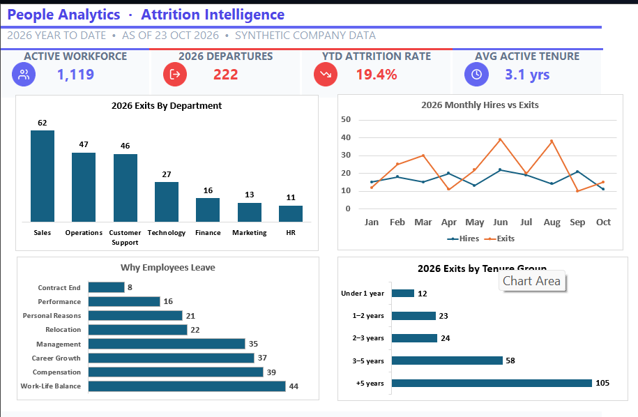
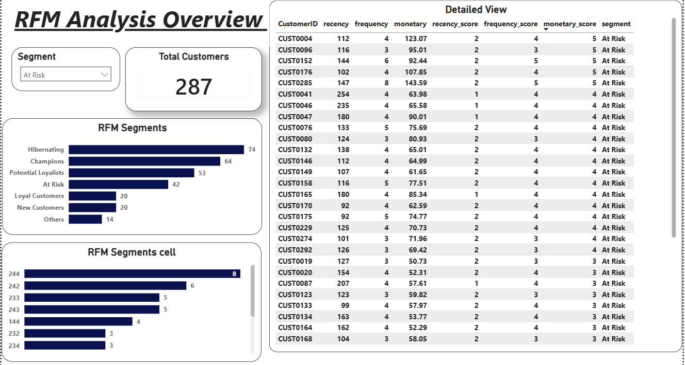
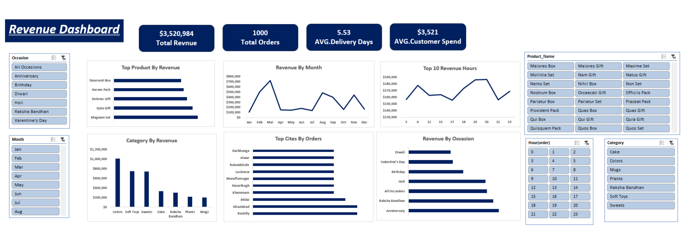

<div align="center">

<!-- HEADER BANNER -->


<!-- QUICK CONTACT & SOCIAL PILLS -->
<p align="center">
  <a href="https://ahmedrasmyabdelrheem.github.io/">
    
  </a>
  &nbsp;
  <a href="https://www.linkedin.com/in/ahmedrasmyabdelrheem">
    
  </a>
  &nbsp;
  <a href="mailto:ahmed.rasmy.abdelrheem@gmail.com">
    
  </a>
  &nbsp;
  <a href="https://ahmedrasmyabdelrheem.github.io/assets/Ahmed_Rasmy_CV.pdf">
    
  </a>
</p>

<!-- VALUE TAGLINE -->
<p align="center">
  <i>"Turning noisy operational records into executive clarity, strategic KPIs, and measurable ROI."</i>
</p>

<!-- QUICK HIGHLIGHT CHIPS -->
<p align="center">
  
  
  
</p>

</div>

---

## 🎯 Executive Profile

I am a **Data & Business Intelligence Analyst** operating at the intersection of **business strategy and analytical data architecture**. 

Rather than treating data as an isolated technical exercise, I partner with stakeholders to diagnose critical operational bottlenecks, forecast customer behavior, and uncover retention dynamics that directly impact profitability.

```text
┌─────────────────────────────────────────────────────────────────────────────┐
│  My Core BI Philosophy:                                                     │
│  Diagnose the Business Bottleneck  ──►  Architect Clean Data Models (Star) │
│  ──► Formulate Actionable KPIs    ──►  Drive Executive Decision-Making     │
└─────────────────────────────────────────────────────────────────────────────┘
```

---

## 💼 Featured Business Intelligence Projects

<div align="center">
  <h3>1. 👥 People Analytics · Workforce Retention & Attrition Intelligence</h3>
  <p>
    
    
    
  </p>
  <p>
    
    
    
    
  </p>

  <!-- DASHBOARD PREVIEW IMAGE -->
  <a href="https://ahmedrasmyabdelrheem.github.io/#projects">
    
  </a>
</div>

<br>

| Pillar | Executive Strategic Context |
| :--- | :--- |
| **🎯 The Business Challenge** | A growing enterprise was facing escalating voluntary employee turnover, triggering unbudgeted hiring costs and severe workflow delays. Leadership lacked analytical visibility into whether departures were concentrated in specific business units, why key employees resigned, and whether senior institutional knowledge was in jeopardy. |
| **💡 The Analytical Solution** | Designed an executive diagnostic solution analyzing **1,600 workforce records** (1,119 active, 481 historical exits). Built dynamic workforce measures in Power Pivot to track opening headcount, average workforce volume, and departure velocity across tenure tiers. |
| **📈 Key Business Discoveries** | • ⚠️ **Senior Talent Drain:** Employees with **+5 years of tenure** made up **47.3% of all 2026 departures (105 out of 222)**, representing massive loss of seasoned expertise.<br>• 🏢 **Department Hotspots:** **Sales (62 exits, 28%)** and **Operations (47 exits, 21%)** accounted for half of all exits.<br>• 🔍 **Primary Resignation Drivers:** **Work-Life Balance (44)**, **Compensation (39)**, and **Career Growth Stagnation (37)** were the primary voluntary drivers.<br>• 📅 **Seasonal Volatility:** Sharp turnover spikes in **June (39 exits)** and **August (38 exits)** revealed predictable summer capacity shortages. |
| **💼 Measurable Business ROI** | Equips HR and C-suite leadership with predictive capacity planning 60 days ahead of summer turnover peaks. Directs targeted retention bonuses and flexible schedule policies toward veteran staff approaching their 4th–5th year milestone—saving tens of thousands in rehiring and productivity loss. |

<p align="center">
  <a href="https://ahmedrasmyabdelrheem.github.io/#projects">
    
  </a>
  &nbsp;
  <a href="https://ahmedrasmyabdelrheem.github.io/assets/People_Analytics_Attrition_Intelligence.xlsx">
    
  </a>
</p>

---

<div align="center">
  <h3>2. 📊 Customer Behavioral Segmentation & RFM Value Optimization</h3>
  <p>
    
    
    
  </p>
  <p>
    
    
    
  </p>

  <!-- DASHBOARD PREVIEW IMAGE -->
  <a href="https://ahmedrasmyabdelrheem.github.io/#projects">
    
  </a>
</div>

<br>

| Pillar | Executive Strategic Context |
| :--- | :--- |
| **🎯 The Business Challenge** | Treating all customer accounts identically across promotional campaigns resulted in diminishing marketing ROI, poor conversion on dormant accounts, and unmonitored defection among previously high-spending clients. |
| **💡 The Analytical Solution** | Formulated an end-to-end data pipeline using **T-SQL** to process 12 months of transactional logs. Applied the statistical **RFM (Recency, Frequency, Monetary)** model to segment 287 accounts into clear behavioral tiers (*Champions, Loyal, At-Risk, Hibernating*), published to an interactive **Power BI** dashboard. |
| **📈 Key Business Discoveries** | • Unmasked a high-margin core of **"Champions"** who generated the majority of repeat revenue but were receiving generic mass promotions.<br>• Identified a critical **"At-Risk"** customer cluster whose ordering frequency dropped significantly over 90 days, signaling imminent churn to competitors. |
| **💼 Measurable Business ROI** | Reallocates marketing expenditures toward personalized retention incentives for at-risk accounts before complete defection, while automating loyalty privileges for top spenders—protecting Customer Lifetime Value (LTV) and reducing customer acquisition dependencies. |

<p align="center">
  <a href="https://github.com/ahmedrasmyabdelrheem/rfm-customer-segmentation">
    
  </a>
  &nbsp;
  <a href="https://app.powerbi.com/view?r=eyJrIjoiOTNmNDQ0OTItM2YxMC00MTdhLWE0MGUtZmFmMGJjMDhlM2MzIiwidCI6ImVhZjYyNGM4LWEwYzQtNDE5NS04N2QyLTQ0M2U1ZDc1MTZjZCIsImMiOjh9">
    
  </a>
</p>

---

<div align="center">
  <h3>3. 📈 Commercial Revenue & Sales Performance Intelligence</h3>
  <p>
    
    
    
  </p>
  <p>
    
    
    
  </p>

  <!-- DASHBOARD PREVIEW IMAGE -->
  <a href="https://ahmedrasmyabdelrheem.github.io/#projects">
    
  </a>
</div>

<br>

| Pillar | Executive Strategic Context |
| :--- | :--- |
| **🎯 The Business Challenge** | Commercial leadership lacked a unified view across products, accounts, and regional territories, blinding decision-makers to where profit leaks were occurring and which product lines produced true margin rather than just surface volume. |
| **💡 The Analytical Solution** | Architected an enterprise-grade **Star Schema** data model in Power Pivot, establishing relational integrity across transaction facts, customer profiles, product catalogs, and calendar dimensions. Developed custom DAX calculations to track Average Order Value (AOV) and product contribution. |
| **📈 Key Business Discoveries** | • Isolated specific high-volume product categories that were experiencing margin erosion due to unmonitored discounting.<br>• Uncovered high revenue concentration risks where a small faction of accounts accounted for an outsized portion of gross margin. |
| **💼 Measurable Business ROI** | Cuts monthly executive reporting overhead from days to real-time. Empowers sales directors with immediate account-level margin visibility during contract renegotiations, protecting company profitability. |

<p align="center">
  <a href="https://github.com/ahmedrasmyabdelrheem/sales-performance-dashboard">
    
  </a>
  &nbsp;
  <a href="https://ahmedrasmyabdelrheem.github.io/assets/Sales_Performance_Dashboard.xlsx">
    
  </a>
</p>

---

## 🛠️ Technical Arsenal & Core Competencies

<div align="center">

| Strategic Domain | Technologies & Core Methodologies |
| :--- | :--- |
| **📊 Business Intelligence & Storytelling** | **Power BI Desktop & Cloud Service**, **DAX** (Complex Measures, CALCULATE, Time Intelligence), **Excel Power Pivot**, **Executive KPI Design**, **Visual Data Storytelling** |
| **🗄️ Relational Databases & SQL** | **Microsoft SQL Server (SSMS)**, **T-SQL**, **Window Functions**, **CTEs & Subqueries**, **Relational Joins**, **Analytical Views** |
| **🔄 Data Modeling & ETL Pipelines** | **Dimensional Modeling (Star & Snowflake Schemas)**, **Power Query ETL**, **Data Cleansing & Validation**, **Granularity & Relationship Management** |
| **🐍 Programming & Exploratory Tools** | **Python (Pandas, NumPy)**, **Exploratory Data Analysis (EDA)**, **Git & GitHub Version Control** |

<br>

<p align="center">
  
</p>

<p align="center">
  
  
  
  
  
  
</p>

</div>

---

## 🎓 Verified Credentials & Certifications

<table align="center" width="100%">
  <tr>
    <td width="33%" align="center">
      <h4>🏛️ DEPI (MCIT)</h4>
      <p><b>Data Analytics - Microsoft Power BI</b></p>
      <p><i>Digital Egypt Pioneers Initiative</i></p>
      <code>2024 – 2025</code>
    </td>
    <td width="33%" align="center">
      <h4>🏛️ NTI & Creativa</h4>
      <p><b>Data Analysis Professional Program</b></p>
      <p><i>National Telecommunication Institute</i></p>
      <code>March 2026</code>
    </td>
    <td width="33%" align="center">
      <h4>🌐 Huawei ICT Academy</h4>
      <p><b>HCIA-AI V4.0 Certification</b></p>
      <p><i>Huawei Global Talent Program</i></p>
      <code>November 2025</code>
    </td>
  </tr>
</table>

<p align="center">
  <a href="https://ahmedrasmyabdelrheem.github.io/#certificates">
    
  </a>
</p>

---

## 📊 GitHub Analytics & Engineering Metrics

<div align="center">

<table>
  <tr>
    <td align="center" width="50%">
      
    </td>
    <td align="center" width="50%">
      
    </td>
  </tr>
</table>

</div>

---

## 🤝 Let's Collaborate on Data & BI Opportunities

I am actively open to discussing roles as a **Data Analyst** or **Business Intelligence Analyst** where I can turn raw operational data into strategic business impact.

<div align="center">

<p align="center">
  <a href="https://ahmedrasmyabdelrheem.github.io/">
    
  </a>
  &nbsp;
  <a href="https://www.linkedin.com/in/ahmedrasmyabdelrheem">
    
  </a>
  &nbsp;
  <a href="mailto:ahmed.rasmy.abdelrheem@gmail.com">
    
  </a>
</p>

<br>

<!-- FOOTER WAVE BANNER -->


</div>
